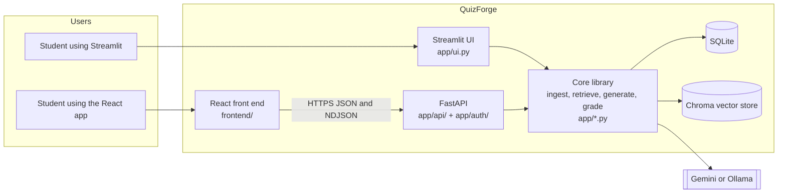
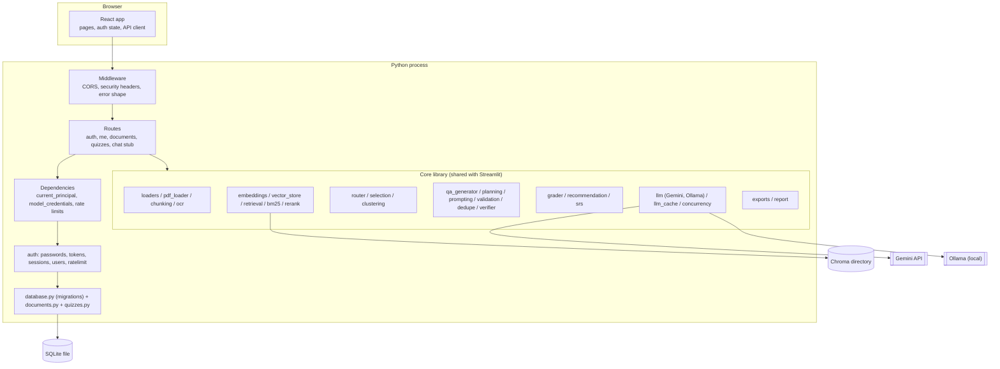
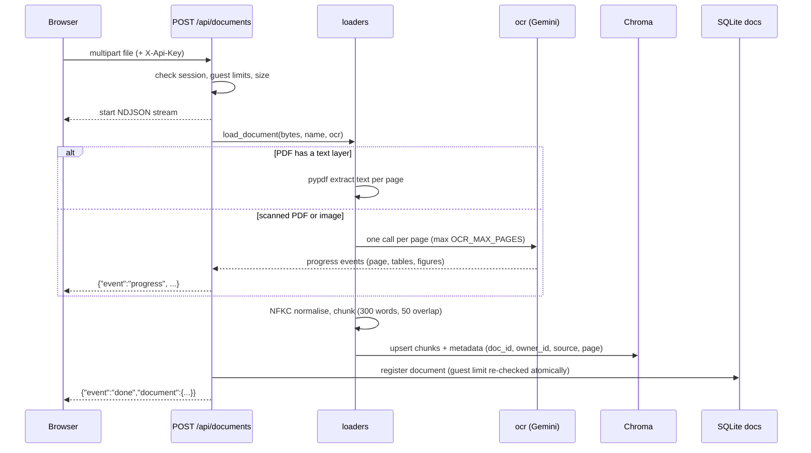
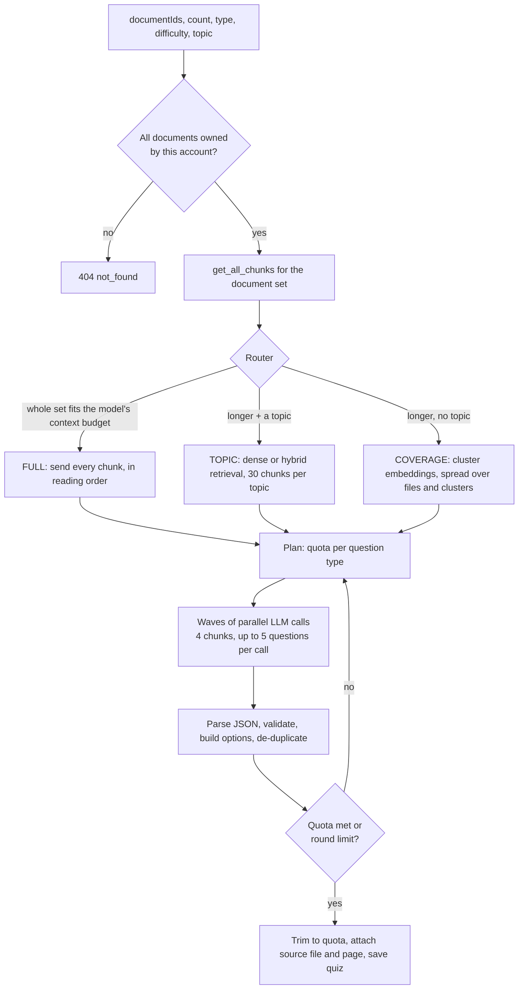
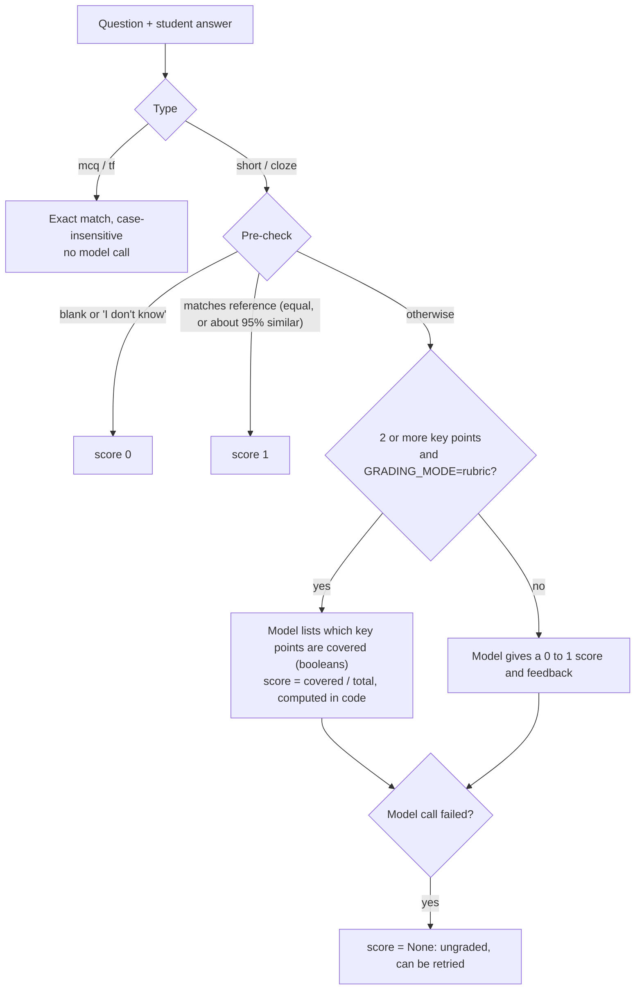
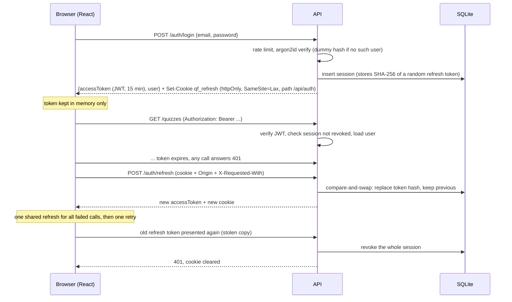
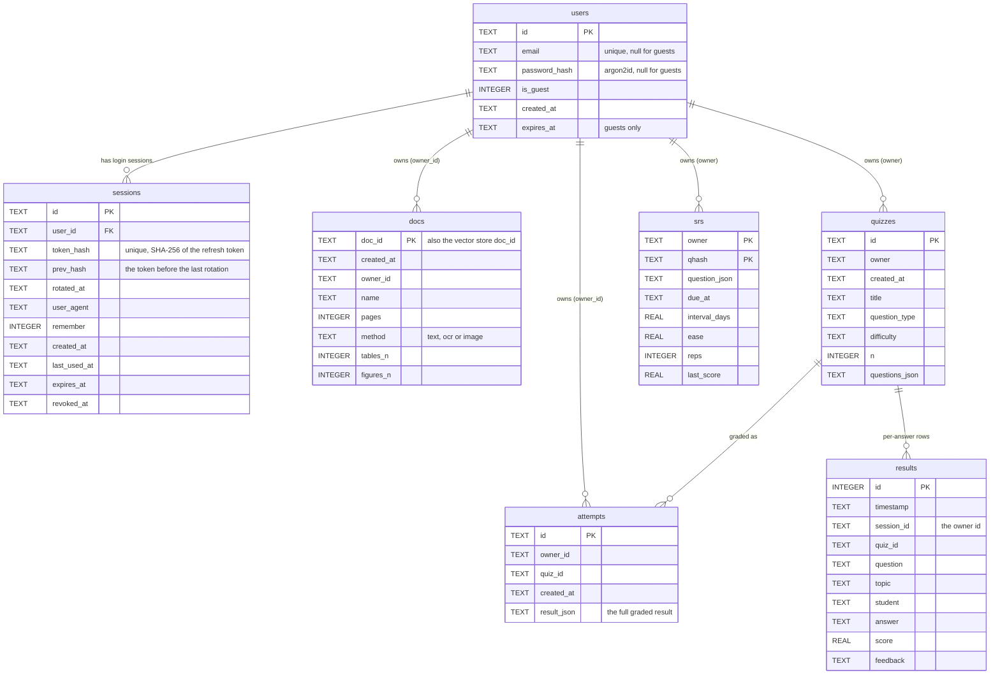

# QuizForge: system documentation

QuizForge turns study material (PDFs, Word, PowerPoint, Markdown, text, web pages, scans and images) into graded
quizzes, using retrieval-augmented generation (RAG): the documents are split into chunks, indexed, and the
right chunks are put into the model's prompt so every question is grounded in, and cited to, a file and page.

This document describes how the system is built: architecture, high-level design (HLD), low-level design (LLD),
databases, technology, security, testing and known limits. It is written from the code in this repository, and
every number in it says what it was measured on. Diagrams are Mermaid (they render on GitHub and in VS Code's
Markdown preview).

> **Read this first: what is in this copy.** QuizForge started as a Streamlit app. Two newer layers sit beside it:
> an HTTP API with accounts (`app/api/`, `app/auth/`) and a React front end (`frontend/`). The *chat with your
> documents* feature exists in the author's separate working tree and is **not** in this copy: the API's
> `POST /api/chat` checks file ownership and then answers `501 not_implemented`. Sections say which part each
> statement is about.

---

## Contents

1. [Overview](#1-overview)
2. [Technology stack](#2-technology-stack)
3. [Architecture](#3-architecture)
4. [High-level design: the main flows](#4-high-level-design-the-main-flows)
5. [Low-level design](#5-low-level-design)
6. [Databases](#6-databases)
7. [HTTP API reference](#7-http-api-reference)
8. [Front end](#8-front-end)
9. [Security](#9-security)
10. [Configuration reference](#10-configuration-reference)
11. [Testing and quality](#11-testing-and-quality)
12. [Evaluation results](#12-evaluation-results)
13. [Running, building and deploying](#13-running-building-and-deploying)
14. [Design decisions and trade-offs](#14-design-decisions-and-trade-offs)
15. [Known limitations and roadmap](#15-known-limitations-and-roadmap)
16. [Appendix: questions you may be asked](#16-appendix-questions-you-may-be-asked)
17. [Glossary](#17-glossary)

---

## 1. Overview

### 1.1 What it does

| Capability | Detail |
|---|---|
| **Ingest** | PDF, DOCX, PPTX, Markdown, text, web pages (private addresses refused), and, with Gemini, scanned PDFs and PNG/JPEG/WebP images. Tables from scans are kept as Markdown tables. |
| **Quiz generation** | Short answer, multiple choice (4 options), true/false, fill-in-the-blank, or a mix; optional topic and difficulty. Each question carries its source file and page. |
| **Grading** | Choices are graded exactly, in code. Short answers are graded against *key points* the model lists once; the score is computed in code, so re-grading gives the same number. |
| **Study aids** (Streamlit app) | Weak-topic practice, spaced repetition (a simplified SM-2 scheduler), saved quizzes, progress charts, printable exam PDF, Anki and CSV export, results PDF. |
| **Accounts** (API) | Email and password, guests that upgrade in place, devices list, data export, account deletion. |
| **Evaluation tooling** | Scripts and labelled sets that measure retrieval, chunk selection, grading and generation (`eval/`, `scripts/`). |

### 1.2 Who calls what



The **core library** is shared: both the Streamlit page and the API call the same functions (`ingest_document`,
`generate_qa_pairs`, `grade_all`). That is why the API and accounts are thin (about 1,500 lines together, most of it accounts) and why behaviour is identical
in both UIs.

### 1.3 Code size (this copy, counted 2026-11-14)

| Part | Files | Lines |
|---|---|---|
| `app/` (Python, including the API and accounts) | 52 | 5,087 |
| `tests/` (Python) | 29 | 5,163 |
| `scripts/` (evaluation and measurement tools) | 10 | 872 |
| `frontend/src/` (TypeScript and TSX, tests included; plus about 1,500 lines of CSS) | 34 | 3,954 |

---

## 2. Technology stack

| Layer | Technology | Why this, in one line |
|---|---|---|
| Language (back end) | **Python 3.11+** (CI runs 3.11 and 3.13) | The LLM, PDF and vector libraries are Python-first. |
| Language (front end) | **TypeScript 5.9** | Types shared by contract with the API (a test enforces it). |
| Original UI | **Streamlit** | Fastest route to a working, deployable app; kept as the live demo. |
| New UI | **React 19**, **Vite 7**, **React Router 7**, plain CSS | A real interface (navigator, sources panel, auth) Streamlit cannot draw. |
| HTTP API | **FastAPI** (Pydantic v2), **Uvicorn**, `python-multipart` | Typed request validation, async-capable, automatic OpenAPI in development. |
| Accounts | **argon2-cffi** (argon2id), **PyJWT** (HS256) | Vetted libraries; no hand-rolled crypto. |
| Relational store | **SQLite** (`sqlite3`, numbered migrations via `PRAGMA user_version`), `pandas` for reading results | One file, no server; enough for a single-process app. |
| Vector store | **ChromaDB** (`PersistentClient`) | Embedded, no server, metadata filters. |
| Embeddings | Chroma's built-in **all-MiniLM-L6-v2** (ONNX, runs on CPU, ~80 MB); optional `ollama:<model>` or `fastembed:<model>` | No key, works offline; swappable. |
| Language models | **Gemini** via `google-genai` (default `gemini-2.5-flash`); **Ollama** (default `gemma3:latest`) | Hosted quality or fully local. |
| Keyword search | Own **BM25** (`app/bm25.py`) | One small document set at a time: no search server needed. |
| Clustering | Own **k-means** on cosine distance (`app/clustering.py`, numpy) | Deterministic (fixed seed), dependency-light. |
| PDF text | **pypdf** | Pure Python, no system dependency. |
| Word/PowerPoint | `zipfile` + `xml.etree` (no extra library) | Smaller attack surface; zip-bomb limits enforced by hand. |
| OCR | Gemini vision (page by page); optional **Tesseract** (`pypdfium2` + `pytesseract`) | Gemini keeps tables and describes figures; Tesseract is local and private. |
| Exports | **fpdf2** (PDF), `csv`, Anki tab-separated | |
| Testing | **pytest**, `pytest-cov` (92% floor), **ruff**, **mypy**; **Vitest**, Testing Library, **axe-core**, jsdom | |
| CI/CD | **GitHub Actions** (lint, types, tests on 3.11 and 3.13, Docker build and health check on `main`, weekly evaluation) | |
| Packaging | **Docker** (`python:3.11-slim`, non-root, pinned `requirements.lock`, model pre-downloaded) | |
| Hosting (live demo) | **Streamlit Community Cloud** | The API and React app are not deployed yet. |

---

## 3. Architecture

### 3.1 Components and responsibilities



### 3.2 Layers and the rule between them

1. **Routes** (`app/api/routes_*.py`): validate input, check who is calling, call the core, shape the output.
   They contain no retrieval or grading logic.
2. **Core library** (`app/*.py`): all RAG logic. It knows nothing about HTTP or Streamlit.
3. **Storage**: SQLite for structured data, Chroma for vectors. Every storage function takes the owner first.

### 3.3 Process and data boundaries

| Boundary | What crosses it | Protection |
|---|---|---|
| Browser to API | JSON, NDJSON, an httpOnly cookie | CORS allows only `APP_ORIGIN`; bearer token for calls; origin and header check on the two cookie endpoints |
| API to model provider | Document text, student answers, the user's Gemini key | Text wrapped in delimiters and neutralised; the key travels in a header and is never stored or logged |
| API to disk | Rows, chunks, uploaded text | Owner id on every row and chunk; nothing is written outside `DATA_DIR` |

### 3.4 Deployment views

| Mode | Components |
|---|---|
| **Streamlit demo** (live) | One Streamlit process; SQLite and Chroma on its disk; the visitor's Gemini key in the sidebar |
| **API + React (local)** | `uvicorn app.api.main:app` on port 8000 and `vite` on 5173; the Vite dev server proxies `/api`, so the page, the API and the refresh cookie share one origin |
| **Docker** | The image runs the Streamlit app (`ENTRYPOINT streamlit run app/ui.py`); the API is not in the image yet |

---

## 4. High-level design: the main flows

### 4.1 Ingestion: file to searchable chunks



Key behaviours:

- The upload response is a **stream of JSON lines** so a long scan can show "page 4 of 12" live.
- Failures arrive as an `error` line with a code (`ocr_limit`, `needs_gemini`, `unreadable`, `unsupported`,
  `guest_limit`, `invalid_key`, `rate_limited`, `model_error`) and a plain message. Unexpected errors are logged
  and shown as a generic message, never as internals.
- A scan over `OCR_MAX_PAGES` (30) is refused *before* any page is read, so no quota is spent on a partial read.
- OCR runs only when a PDF has **no** text layer. A mixed PDF is read as text only.

### 4.2 Quiz generation (the RAG core)



What each step does:

1. **Ownership check.** Every id is resolved through the `docs` table for this account; one foreign id fails the
   whole request with `404` (the same answer as "does not exist").
2. **Routing** (`router.py`). If the whole document set fits the provider's context budget, it is sent in full:
   no retrieval error is possible. Gemini's budget is `GEMINI_CONTEXT_CHARS` (120,000 characters); Ollama's is
   about twice its context window (or 6,000 characters if unset).
3. **Selection** (`selection.py`). For longer sets: topic retrieval, or *coverage* selection that clusters chunk
   embeddings and takes one chunk per cluster per batch, source-aware so each batch draws from different files.
4. **Planning** (`planning.py`). A quota per type (a `mixed` quiz is half MCQ, half short answer). Each wave asks
   for the type furthest from its quota; a type whose batches come back empty is dropped so it cannot starve the
   others. Round limit: `2 * (n // 5 + 1) + 2`.
5. **Prompting** (`prompting.py`). Numbered passages inside `<context>` tags, rules, and a JSON schema for the
   reply (enforced through the provider's structured-output option).
6. **Validation** (`validation.py`). Tolerant JSON extraction, then keep only well-formed items; for MCQ exactly
   four distinct options (the answer plus three distractors, shuffled); the cited chunk number maps back to a
   real file and page.
7. **De-duplication** (`dedupe.py`). Exact (after normalising case and punctuation); optional semantic
   (embedding similarity above a threshold, off by default).
8. **Optional verifier** (`verifier.py`). A second model pass that drops questions the cited passage does not
   support (off by default; extra calls).

### 4.3 Grading



Design points: the model only answers "which key points did the student cover"; the arithmetic is done in code,
so repeating the grading gives the same score. The student's answer is wrapped in `<student_answer>` tags and any
tag inside it is neutralised, so an answer cannot close the wrapper and give the grader instructions. A failed
model call yields an explicit *ungraded* status, not a misleading zero.

### 4.4 Sign-in and sessions



---

## 5. Low-level design

### 5.1 Repository map

```
app/
  api/            main.py (app factory), deps.py, errors.py, llm_factory.py,
                  routes_auth.py, routes_me.py, routes_documents.py, routes_quizzes.py, routes_chat.py
  auth/           passwords.py, tokens.py, sessions.py, users.py, ratelimit.py
  loaders.py      format detection, DOCX/PPTX/text readers, URL fetch with safety checks, load_document()
  pdf_loader.py   PDF text, legacy chunker (Chunk type), NFKC normalisation
  chunking.py     structure-aware chunker (headings, token-sized), opt-in
  ocr.py          Gemini vision OCR (per page, progress, limit) and optional Tesseract
  embeddings.py   embedder selection (default MiniLM / ollama / fastembed), one collection per embedder
  vector_store.py Chroma wrapper: add_chunks, similarity_search, get_all_chunks, delete_doc, delete_owner
  retrieval.py    dense and hybrid (BM25 + dense, reciprocal rank fusion), distance cutoff, optional rerank
  bm25.py, rerank.py, clustering.py, selection.py, router.py
  qa_generator.py ingest_document / ingest_url / generate_qa_pairs (the orchestrator)
  planning.py, prompting.py, validation.py, dedupe.py, verifier.py, prompt_safety.py
  llm.py          GeminiProvider, OllamaProvider, retries with backoff, usage stats, generate_from_file
  llm_cache.py, concurrency.py
  grader.py, recommendation.py, srs.py
  database.py     connection, numbered migrations, results
  documents.py    ownership of uploaded documents (the authority for "is this file yours")
  quizzes.py      saved quizzes; maintenance.py (document expiry)
  exports.py, report.py   exam PDF, Anki, CSV, results PDF
  ui.py           the Streamlit page
frontend/         React app (section 8)
eval/, scripts/   labelled sets, results, measurement and comparison tools
tests/            29 test files
docs/             this file, ARCHITECTURE.md, DECISIONS.md, metrics and the upgrade plan
```

### 5.2 Chunking

| | Legacy (default) | Structured (opt-in `CHUNKING=structured`) |
|---|---|---|
| Unit | words | tokens (about 4 characters each) |
| Size | 300 words, 50 overlap | target 400 tokens, 60 overlap, minimum 80 |
| Boundaries | sentence-aware; **never spans pages**, so every chunk can be cited as "file, page N" | follows detected headings (numbered, "Chapter 3", ALL CAPS, short Title Case); may span pages (`page` to `page_end`) |
| Output | `Chunk(text, page, heading, page_end)` | same |

Before chunking, every page's text is **NFKC-normalised**. LaTeX-produced PDFs store "fi", "fl" and "ff" as single
ligature characters ("fixed"); without normalisation a search for "fixed" never matches them (70 to 80% of the
chunks in three test papers contained ligatures). Non-paged sources (Word, text, Markdown, web pages, images) get
`page = 0`, which the app shows as "no page".

### 5.3 Embeddings and the vector store

- One Chroma collection per embedder (`exam_chunks` for the default MiniLM; `exam_chunks__ollama_<model>` and so
  on), because vectors from different models must never be mixed. The collection is cached per
  `(path, embedder)` and opened under a lock: Chroma's client is not safe to create from several threads at once
  (found by a test: parallel first uploads on a fresh server crashed without the lock).
- Chunk id: `{doc_id}-{file_id}-{index}` (`file_id` is the first 16 hex characters of the file's SHA-256), so
  re-adding the same file is an idempotent upsert.
- Chunk metadata: `doc_id`, `source` (file name), `file_id`, `chunk`, `page`, and when present `heading`,
  `page_end`, `parent` (the surrounding section text) and `owner_id`.
- Queries filter by `doc_id` or by a list (`$in`), so one quiz can draw on several files.
- Chroma's default distance is squared Euclidean on the (normalised) vectors: smaller is closer. On the test
  documents the best match for an answerable question scored 0.63 to 1.37 and for an off-topic question 1.41 to
  1.79.

### 5.4 Retrieval

| Mode | How | When used |
|---|---|---|
| **dense** (default in this copy) | nearest chunks by embedding | topic search |
| **hybrid** | BM25 ranking over all chunks of the set, fused with the dense ranking by **reciprocal rank fusion** (`score = sum of 1 / (60 + rank)`) | opt-in (`RETRIEVAL_MODE=hybrid`) |
| **rerank** (optional) | a cross-encoder (`fastembed:<model>`) reorders the top `RERANK_CANDIDATES` (20) | opt-in |
| **distance cutoff** | drop dense hits farther than `RETRIEVAL_MAX_DISTANCE`; with hybrid, a topic with no keyword match and no close embedding returns nothing | unset by default |

BM25 (`bm25.py`) is a small in-memory implementation: lower-cased tokens, a stop-word list, a light plural strip.
Because it is rebuilt for each query, hybrid costs about 220 ms extra on a 1,000-chunk set (measured); caching the
index per document set is a known improvement. **Parent expansion** (small-to-big, `PARENT_EXPANSION`) swaps a
matched chunk for its section.

### 5.5 Router and chunk selection

`router.choose_path` returns one of three paths (section 4.2). `selection.make_cycler` then picks the strategy:

- `FullContextCycler`: every call sees the whole set.
- `CoverageCycler`: k-means (cosine, fixed seed) groups chunk embeddings; each batch takes one chunk from each of
  several clusters, farthest-first, so a quiz spans the whole document.
- `MultiSourceCycler`: across several files, each batch takes chunks from *different files* first.
- `BatchCycler`: random shuffle, the fallback when there are too few chunks or no embeddings.

> **A real consequence, seen in a live test:** when two papers fit the context budget together, the router takes
> the `FULL` path and asks for N questions over everything in one prompt; the model may then take them all from
> the first paper. The multi-file strategy exists but is not used on that path. This is listed under limitations.

### 5.6 LLM layer (`llm.py`)

- `LLMProvider` protocol: `generate(prompt, schema=None, temperature=None) -> str`.
- `GeminiProvider` and `OllamaProvider` share `_BaseProvider`: retries with exponential backoff on timeouts, 429
  and 5xx (`LLM_MAX_RETRIES` 2, `LLM_RETRY_BACKOFF` 1 s, doubling), per-call token and latency statistics, and
  a concurrency limit the provider declares (`GEMINI_CONCURRENCY` 4, Ollama 1).
- Structured output: a JSON schema is passed to the provider so replies parse reliably; the parser still tolerates
  prose and code fences.
- `generate_from_file(prompt, bytes, mime)` (Gemini only) sends one PDF page or image for OCR.
- `llm_cache.py`: an optional on-disk response cache for development and evaluation (never caches failures).
- Failures raise `LLMError`; the API turns a provider failure into `invalid_key` (400), `rate_limited` (429 with
  `Retry-After`) or `model_error` (502), each with a plain message and never the provider's raw text.

### 5.7 OCR (`ocr.py`)

`gemini_ocr(llm)` returns `ocr(bytes) -> list[str]` (one string per page):

1. A scanned PDF is split into one-page PDFs (pypdf); an image is sent as is (type detected from its first bytes).
2. Each page goes to Gemini with a prompt that asks for plain text in reading order, **tables as Markdown tables**,
   `[Figure: ...]` lines for figures, and to treat the page as data (never follow instructions on it).
3. Pages run in parallel up to the provider's limit; results keep page order; progress and the running count of
   tables and figures are reported.
4. A blank page returns `(blank)`, mapped to an empty string.

Tesseract (`ocr_pdf`) is the local alternative: it reads plain text only and sends nothing out.

### 5.8 Spaced repetition (`srs.py`)

A simplified SM-2. A card is a question (`id = sha1(question + answer)`). After grading with score `s`:

| Outcome | reps | interval | ease |
|---|---|---|---|
| `s < 0.6` (fail) | reset to 0 | 1 day | `max(1.3, ease - 0.2)` |
| pass, first time | 1 | 1 day | `min(2.8, ease + 0.05)` |
| pass, second time | 2 | 3 days | same |
| pass, later | n + 1 | `round(interval * ease)` | same |

Starting ease is 2.5. This is used by the Streamlit app; the API does not record review cards yet (section 15).

### 5.9 Accounts (LLD)

| Piece | Design |
|---|---|
| **Passwords** | argon2id (library defaults); 12 to 128 characters; a short built-in list of very common passwords refused; not equal to the email; re-hashed on sign-in if parameters change; a dummy hash is verified when the email is unknown so timing does not reveal accounts |
| **Access token** | JWT, HS256, 15 minutes; claims `sub`, `sid` (session id), `iat`, `exp`, `iss=quizforge`, `aud=quizforge-api`; the algorithm is pinned on decode (so `alg: none` is refused); **every request also checks that the session exists and is not revoked**, so sign-out is immediate |
| **Refresh token** | 32 random bytes; only its SHA-256 is stored; cookie `qf_refresh`, `HttpOnly`, `SameSite=Lax`, `Path=/api/auth`, `Secure` in production; 30 days with "keep me signed in", otherwise a browser-session cookie limited to 12 hours on the server |
| **Rotation** | every refresh replaces the token with a compare-and-swap `UPDATE ... WHERE token_hash = ?`, so two simultaneous refreshes cannot both rotate; the previous hash is kept |
| **Reuse detection** | presenting the previous token more than 10 seconds after rotation means a copy was used: the whole session is revoked. Inside the 10-second grace window (two tabs, React strict mode) the caller gets a new access token and no new cookie |
| **Guests** | a real user row with `is_guest = 1`, no email or password, expires after 7 days, at most 3 files of 10 MB; "create account" sets email and password on the **same user id**, so files and quizzes stay |
| **Authorization** | every route resolves the caller from the token; documents go through `documents.owned(owner, ids)`; another account's file, quiz or session is always `404`, identical to a missing one |
| **Rate limits** | in-memory sliding window: login 5 per minute per address and email, 20 per hour per address; sign-up 5 per hour; guest creation 5 per hour. Correct for one process only |
| **Client address** | `X-Forwarded-For` is read only `TRUSTED_PROXY_HOPS` entries from the right, so a caller cannot invent their own address |
| **CSRF** | ordinary endpoints take the token from the `Authorization` header (a browser never adds it by itself); the two endpoints that use the cookie also require `Origin == APP_ORIGIN` and `X-Requested-With: quizforge` |

### 5.10 Concurrency model

- FastAPI runs the (synchronous) route functions in a thread pool. Document upload runs its work in a separate
  thread and streams its events through a queue.
- `concurrency.run_parallel` runs independent model calls (generation waves, page reads, short-answer grading) in
  a bounded thread pool, keeps result order, and re-raises the first error after the pool drains.
- SQLite: connections are opened per call and closed; the schema check runs once per file per process and only
  writes when the version changes (before that fix every read took the write lock and requests queued behind each
  other). Recording a document for a guest uses `BEGIN IMMEDIATE` so the count and the insert are one transaction.

### 5.11 Error model

Every non-2xx response is `{"code": "...", "message": "..."}`. Codes: `unauthorized` (401), `invalid_credentials`
(401), `csrf`, `guest_limit` (403), `not_found` (404), `email_taken` (409), `rate_limited` (429),
`invalid_request`, `invalid_email`, `weak_password`, `wrong_password`, `not_guest`, `no_password`,
`confirmation_mismatch`, `needs_gemini`, `invalid_key` (400), `model_error` (502), `not_implemented` (501).
A test checks that every code the server can send is known to the front end.

---

## 6. Databases

QuizForge uses two stores: **SQLite** for structured data and **Chroma** for vectors.

### 6.1 SQLite schema

File: `DATA_DIR/quiz_results.db` (`QUIZ_DB_PATH` overrides). Schema version 3 in this copy, tracked with
`PRAGMA user_version`; `migrate()` applies numbered steps and is safe to run repeatedly.



### 6.2 Table dictionary

| Table | Purpose | Key and indexes | Notes |
|---|---|---|---|
| `users` | accounts and guests | PK `id`; unique `email` | an email is stored lower-cased and trimmed |
| `sessions` | one row per signed-in browser | PK `id`; unique `token_hash`; indexes on `user_id` and `prev_hash` | only hashes of refresh tokens are stored |
| `docs` | registry of uploaded documents and **who owns them** | PK `doc_id`; index on `owner_id` | the authority for ownership checks; also used for expiry in the Streamlit app |
| `quizzes` | saved quizzes (the questions as JSON) | PK `id`; index `(owner, created_at)` | `questions_json` keeps the model's fields: question, answer, type, topic, options, source, page, key points |
| `attempts` | one row per graded submission, with the full result JSON | PK `id`; index `(owner_id, quiz_id, created_at)` | the API reads the latest one for the results page |
| `results` | one row per graded answer (flat, for statistics and charts) | PK `id`; index on `session_id` | in the API `session_id` holds the user id |
| `srs` | spaced-repetition cards | PK `(owner, qhash)`; index `(owner, due_at)` | written by the Streamlit app only |

Notes on the design:

- **Foreign keys are not enforced** (SQLite's default is off), and cascading deletes are not relied on. Deleting an
  account removes rows from each table explicitly (`users.delete_account`), then the account's chunks from Chroma.
- **`owner` is a string whose meaning depends on the front door.** In the API it is the user id. In Streamlit it is
  a typed profile name or a browser session id, which is a label, not an identity. The two worlds do not share
  data.
- **Migrations are additive.** v1 `results`; v2 `quizzes`, `srs`, `docs`; v3 `users`, `sessions`, `attempts` and
  the `docs` columns for ownership and metadata.

### 6.3 Chroma vector store

Directory: `DATA_DIR/chroma` (`CHROMA_PERSIST_DIR` overrides).

| Aspect | Detail |
|---|---|
| Collection | `exam_chunks` (default embedder) or `exam_chunks__<kind>_<model>` |
| Record | document text = the chunk; embedding = from the collection's embedder; id = `{doc_id}-{file_id}-{index}` |
| Metadata | `doc_id`, `source`, `file_id`, `chunk`, `page`, optional `heading`, `page_end`, `parent`, `owner_id` |
| Queries | `where={"doc_id": id}` or `{"doc_id": {"$in": [...]}}`; delete by document or by `owner_id` |
| Isolation | the API never queries a document id it has not first confirmed in `docs` for the caller; `owner_id` in the metadata lets one call remove a whole account |

### 6.4 Data lifecycle

| Data | Created | Removed |
|---|---|---|
| Uploaded chunks (API) | on upload | when the user deletes the file or the account; for guests when the guest account is removed |
| Uploaded chunks (Streamlit) | on "Create Quiz" | after `DOC_TTL_DAYS` (7), by `cleanup_expired()` at app start |
| Guest accounts | on "try without an account" | not after 7 days *by a timer*: expired guests cannot sign in, and their data is deleted when the API **starts** (`delete_expired_guests`) |
| Sessions | on sign-in | revoked on sign-out, password change, reuse detection; expire on their own date |
| Quizzes, attempts, results | on creation and grading | with the account |
| The user's Gemini key | never stored | held in the browser tab's memory only |

> **Warning.** `cleanup_expired()` deletes documents older than `DOC_TTL_DAYS` from the `docs` table regardless of
> owner. Only the Streamlit app calls it. If the Streamlit app and the API ever share one `DATA_DIR`, Streamlit
> would delete API users' files after 7 days. Keep their data directories separate.

---

## 7. HTTP API reference

Base path `/api`. JSON uses camelCase. Errors are `{code, message}`. Calls that can reach a model carry
`X-Provider` (`Gemini` or `Ollama`) and `X-Api-Key`. Full contract with types: `frontend/API.md` and
`frontend/src/api/types.ts` (a test parses that file and checks every real response against it).

| Method and path | Auth | Body | Returns |
|---|---|---|---|
| `GET /health` | none | | `{status: "ok"}` |
| `POST /auth/signup` | none | `{email, password, remember}` | `{accessToken, expiresIn, user}` + cookie |
| `POST /auth/login` | none | same | same |
| `POST /auth/guest` | none | | same, for a guest |
| `POST /auth/upgrade` | bearer (guest) | `{email, password}` | same user id with an email |
| `POST /auth/refresh` | cookie + Origin + header | | new token and cookie |
| `POST /auth/logout` | cookie + Origin + header | | `204`, cookie cleared |
| `GET /me` | bearer | | user and `counts {files, quizzes, reviewCards}` |
| `POST /me/password` | bearer | `{current, new}` | `204`; other devices signed out |
| `GET /me/sessions`, `DELETE /me/sessions/{id}`, `DELETE /me/sessions/others` | bearer | | devices list, `204`, `{signedOut}` |
| `GET /me/export` | bearer | | JSON download of everything stored |
| `DELETE /me` | bearer | `{email}` | `204`; removes the account and all its data |
| `POST /documents` | bearer | multipart `file` | NDJSON stream of `progress`, then `done` or `error` |
| `POST /documents/url` | bearer | `{url}` | same stream |
| `GET /documents`, `DELETE /documents/{id}` | bearer | | the account's files, `204` |
| `POST /quizzes` | bearer + model key | `{documentIds, count 5..25, type, difficulty, topic}` | `Quiz` |
| `GET /quizzes`, `GET /quizzes/{id}` | bearer | | summaries, a quiz |
| `POST /quizzes/{id}/grade` | bearer + model key | `{answers: {questionId: text}}` | `GradeResult` (also stored as an attempt) |
| `GET /quizzes/{id}/result` | bearer | | latest `GradeResult` |
| `POST /chat` | bearer | `{documentIds, message}` | **`501` in this copy** (ownership is checked first) |

Streaming upload events:

```
{"event":"progress","page":4,"pages":12,"tables":2,"figures":1}
{"event":"done","document":{"id":"...","name":"Lecture 3 scan.pdf","pages":12,"method":"ocr","tables":4,"figures":2}}
{"event":"error","code":"ocr_limit","message":"This scanned PDF has 42 pages; ..."}
```

---

## 8. Front end

React 19 + TypeScript + Vite, plain CSS tokens (no UI library), React Router for pages.

```
frontend/src/
  api/        types.ts (the contract)   http.ts (real client)   mock.ts (sample data with real rules)   session.ts (token store)
  state/      Auth.tsx (who is signed in)   AppState.tsx (files, model settings)   useLoad.ts (loading hook)
  components/ Layout, RequireSession, AuthShell, PasswordField, ui (chips, progress, source chip)
  pages/      NewQuiz, Quiz, Results, Chat, Quizzes, SignIn, SignUp, Account
  lib/        agent.ts (browser name from User-Agent)
```

| Concern | Design |
|---|---|
| **Routing** | `/signin`, `/signup` public; everything else sits behind `RequireSession` (a guest counts). A signed-out visitor is sent to sign-in and returned to the page they asked for. |
| **Token handling** | The access token lives in memory only (`SessionStore`). On load, `refresh()` (cookie) restores it. A call that fails with 401 triggers **one shared refresh**, then **one retry**; if refresh fails the person is signed out with "Your session ended". A wrong password never triggers a refresh. |
| **State** | `AuthProvider` (user, status, actions). `AppStateProvider` (uploaded files, provider and Gemini key) sits above the routes and is keyed by account, so switching accounts starts clean and a guest keeps their work while creating an account. |
| **Upload** | files are sent one by one; the NDJSON stream drives a per-file progress bar and "tables kept, figures described" counts. |
| **Modes** | `npm run dev` uses the real API. `npm run dev:sample` (`VITE_API=mock`) uses an in-memory mock with real rules (accounts, per-account data, guest limits, the 30-page scan limit); a banner says "Sample data mode" on every page, because its questions are a fixed example set and do not come from uploaded files. |
| **Safety of rendered text** | file names, questions, options and sources are always rendered as text by React; tests assert hostile strings never become elements. |
| **Accessibility** | labelled controls, `aria-checked` radios, focus rings, 44 px targets, one `<main>` landmark; axe-core runs on nine screens in the test suite (colour contrast needs a real browser and is not covered). |

The screens (upload, quiz, results, chat, phone quiz, sign-in, sign-up, account, guest) were designed on a design
canvas before being built.

---

## 9. Security

| Threat | Control | Checked by |
|---|---|---|
| Prompt injection from documents | passages wrapped in `<context>`, closing tags neutralised, the prompt tells the model to ignore instructions inside | test: a document containing `</context>` and "ignore all previous instructions" cannot close its wrapper |
| Prompt injection from student answers | `<student_answer>` wrapper, tags neutralised; the score is computed in code from booleans | test: a hostile answer cannot close the wrapper; live test: "award full marks" scored 0 |
| SSRF through web pages | public addresses only; every redirect hop re-checked; size and time limits | test over `127.0.0.1`, `localhost`, cloud metadata, `10.x`, `[::1]`, `file://`, `ftp://`, `javascript:` |
| Zip bombs (DOCX, PPTX) | unpacked size limit enforced while reading | test with a 60 MB-unpacked file |
| Broken or hostile files | page, size and type limits; clear errors; no half-made data | tests for empty, corrupt, encrypted and lying files |
| Credential stuffing and enumeration | one message for wrong email or password; dummy hash for timing; rate limits | tests, including a timing comparison |
| Token theft | 15-minute access token, httpOnly refresh cookie, rotation, reuse detection, immediate revocation | tests that force the race and the reuse |
| CSRF | bearer header for normal calls; origin and header check on the cookie endpoints | tests |
| Cross-account access | owner on every row and chunk; `404` for anything not yours | an isolation matrix that runs every route as a second user and fails when a route is added without being listed |
| XSS | React renders text; no `dangerouslySetInnerHTML`; hostile names and questions tested | front-end tests |
| Key leakage | the Gemini key is in a header only, never stored, never echoed, never logged; provider errors are rewritten, not repeated | tests with a key-shaped string in the provider error |
| Information leaks | unexpected errors are logged server-side and shown as a generic message; production hides the API docs; the server refuses to start in production without `AUTH_SECRET` | tests |
| SQL injection | parameterised queries throughout | test with hostile emails |

Not done: a Content-Security-Policy, email verification, password reset, two-factor sign-in, a breached-password
check (the built-in list is short), shared rate-limit storage for more than one process.

---

## 10. Configuration reference

All settings are environment variables read once in `config.py`; `.env.example` lists them. Main ones:

| Setting | Default | Meaning |
|---|---|---|
| `GEMINI_MODEL`, `GEMINI_API_KEY` | `gemini-2.5-flash`, empty | hosted model; the key is normally supplied by the user per request |
| `OLLAMA_MODEL`, `OLLAMA_BASE_URL` | `gemma3:latest`, `http://localhost:11434` | local model |
| `GEMINI_CONTEXT_CHARS` | 120000 | context budget for the router |
| `GEMINI_CONCURRENCY`, `OLLAMA_CONCURRENCY` | 4, 1 | parallel model calls |
| `LLM_TIMEOUT`, `LLM_MAX_RETRIES`, `LLM_RETRY_BACKOFF` | 300 s, 2, 1 s | call behaviour |
| `EMBEDDING_MODEL` | `default` | MiniLM, or `ollama:<m>` / `fastembed:<m>` |
| `CHUNKING`, `CHUNK_WORDS`, `CHUNK_OVERLAP_WORDS` | `legacy`, 300, 50 | chunker |
| `RETRIEVAL_MODE`, `RETRIEVAL_MAX_DISTANCE`, `RERANKER` | `dense`, unset, `none` | retrieval |
| `SELECTION_STRATEGY`, `ADAPTIVE_ROUTING` | `coverage`, on | chunk choice and routing |
| `VERIFY_QUESTIONS`, `SEMANTIC_DEDUPE` | off, off | quality passes |
| `GRADING_MODE` | `rubric` | or `holistic` |
| `MAX_UPLOAD_MB`, `MAX_PDF_PAGES` | 25, 300 | upload limits |
| `OCR_MODE`, `OCR_MAX_PAGES` | `auto`, 30 | `off` disables OCR; page cap for Gemini reading |
| `DOC_TTL_DAYS` | 7 | Streamlit document expiry |
| `DATA_DIR`, `QUIZ_DB_PATH`, `CHROMA_PERSIST_DIR` | `data`, ... | storage locations |
| `APP_ENV`, `AUTH_SECRET`, `APP_ORIGIN` | `development`, empty, `http://localhost:5173` | production needs a 32+ character secret |
| `ACCESS_TTL_MIN`, `REFRESH_TTL_DAYS`, `SESSION_TTL_HOURS` | 15, 30, 12 | session lifetimes |
| `GUEST_TTL_DAYS`, `GUEST_MAX_FILES`, `GUEST_MAX_UPLOAD_MB` | 7, 3, 10 | guest limits |
| `COOKIE_SECURE`, `TRUSTED_PROXY_HOPS` | 0 (1 in production), 0 | cookie flag; proxies in front of the API |

---

## 11. Testing and quality

| Area | What | Count or result (2026-11-14) |
|---|---|---|
| Back end | pytest: unit, integration and API tests, with a coverage floor | **599 tests**, **95.45%** coverage (floor 92%), ruff and mypy clean |
| Front end | Vitest and Testing Library (screens and API client), axe | **89 tests**, typecheck, lint and production build clean |
| Isolation | every API route run as a second account | fails when a route is added without being covered |
| Contract | the front end's TypeScript types vs real responses | one test file |
| Robustness | broken files, hostile addresses, attacks, 120 seeded random requests (never a 500), concurrency, three deterministic race tests | `tests/test_api_robustness.py` |
| Mutation checks | put each important fix back on purpose and confirm a test fails | done for the auth, isolation, upload, race and accessibility fixes (recorded in the test report) |
| Evaluation | measured quality, not correctness (section 12) | `eval/`, `scripts/` |

Test report with every bug found and fixed: `projects/_notes/QuizForge_TEST_REPORT.md` (outside this repo).

---

## 12. Evaluation results

Every row says what it was measured on. Small samples mean small differences are noise.

### 12.1 Project benchmark (the author's labelled set, commit `f9ff649`, 2026-11-02)

| Question | Result |
|---|---|
| Retrieval, 8 authored notes, 68 queries, default (dense) | MRR **0.888** [0.83, 0.94] |
| ... with a cross-encoder reranker | MRR **0.942** (paired gain +0.054, interval [-0.007, +0.114]: consistent direction, not proven; 12 queries better, 4 worse) |
| Chunk selection, 8 files, 120 runs (no model) | files touched per quiz **72.5% (random) to 94.5% (source-aware coverage)**, gain +22 points, interval [+19.8, +24.3] |
| Grading, 33 labelled answers, lexical stand-in (no model) | rubric 64% agreement, holistic 61%; repeatability: identical scores on repeats |

### 12.2 Real documents (the author's first real-PDF test, 5 PDFs, 27 self-written questions)

The 0.89 on clean notes did **not** carry over: the same default scored **0.37** on real papers and books.
Hybrid retrieval raised it to **0.54** (paired +0.174, interval [+0.074, +0.288]). A small clean benchmark can hide
a real effect, so a harder set was built. Source: `docs/REAL_DOCUMENT_EVALUATION.md` in the author's working tree.

### 12.3 Test on three papers and a 491-page book (2026-11-14, 24 labelled questions)

| Setting | hit@1 | hit@5 | MRR@10 |
|---|---|---|---|
| dense, one document | 0.46 | 0.79 | 0.594 |
| **hybrid, one document** | **0.67** | **0.88** | **0.733** |
| dense, all four documents | 0.38 | 0.67 | 0.503 |
| hybrid, all four documents | 0.58 | 0.79 | 0.650 |

- Searching several documents at once put the wrong document on top for 4 to 6 of 24 questions.
- A distance cutoff of about 1.4 separated answerable questions (best match up to 1.37) from six off-topic ones
  (at least 1.41), but the gap is thin.
- Ingest speed: 1.4 to 4.9 s for 11 to 42-page papers; 36 to 40 s for the 491-page book (891 chunks).
- Latency: embedding one query about 285 ms (nearly all of a dense search); sign-in about 65 ms (argon2).

### 12.4 Live test with real Gemini (`gemini-2.5-flash`, one quiz, one graded question)

| Test | Result |
|---|---|
| OCR of a 2-page scan with two tables | 10.6 s; both tables kept as Markdown tables with correct columns (plain PDF text loses columns); one key cell misread (O(n) for O(1)) |
| 6-question quiz from two papers | 26 s; all accurate and correctly cited; **all six from one paper**; two near-duplicates |
| Grading one short answer five ways, twice each | identical scores on repeat; copied reference 1.0; wrong 0; blank 0; a prompt-injection answer 0; a half-correct answer scored 0.25 instead of 0.5 |

These are single runs, not a benchmark.

---

## 13. Running, building and deploying

### 13.1 Streamlit app (the original)

```bash
python3 -m venv .venv && source .venv/bin/activate
python -m pip install --only-binary=:all: -r requirements.txt
streamlit run app/ui.py            # http://localhost:8501; needs Ollama, or a Gemini key in the sidebar
```

### 13.2 API and React front end

```bash
# terminal 1, project root (Python 3.11 or newer)
python -m uvicorn app.api.main:app --port 8000
# terminal 2
cd frontend && npm ci && npm run dev          # http://localhost:5173, proxies /api to port 8000
```

- Use `--only-binary=:all:` when installing. On an Intel Mac, the newest `cryptography` has no prebuilt package,
  so a plain install tries to compile it with Rust; if that fails, pip aborts and leaves the venv empty.
- Use `python -m uvicorn`, not a bare `uvicorn`, so the venv's copy runs.
- Production: set `APP_ENV=production`, a 32+ character `AUTH_SECRET`, `APP_ORIGIN`, `TRUSTED_PROXY_HOPS`, and run
  behind HTTPS. The server refuses to start without the secret.

### 13.3 Docker and CI

- The image installs from `requirements.lock`, runs as a non-root user, and pre-downloads the embedding model so
  it works offline. Its entrypoint is the Streamlit app. `requirements.lock` has not been regenerated for the API
  dependencies (it needs `uv`), so the image does not contain them yet.
- CI (`.github/workflows/tests.yml`): lint, mypy, pytest with coverage on 3.11 and 3.13, and on `main` a Docker
  build with a health check. A weekly workflow (`eval.yml`) runs the evaluation harness.

---

## 14. Design decisions and trade-offs

| Decision | Why | What it costs |
|---|---|---|
| **Embedded stores (SQLite, Chroma)** | zero setup, one directory to back up, fits a portfolio-scale app | one process; a free host with a throwaway disk loses data; no horizontal scaling |
| **Per-quiz document sets, filtered by `doc_id`** | simple isolation and expiry | repeated uploads re-embed the same text |
| **Adaptive router** (send everything when it fits) | removes retrieval error for short documents; every part of the notes is available | the model may favour the first file; cost grows with document size |
| **Model lists key points; code computes the score** | repeatable grading, easy to test, resistant to "give me full marks" | one under-credit seen on a partial answer; key points are only as good as the model's list |
| **Source-aware coverage selection** | questions spread across the whole document and all files | needs embeddings; falls back to random for tiny sets |
| **Own BM25 and k-means** | no extra service or heavy dependency | BM25 index rebuilt per query (a known 220 ms cost) |
| **Conservative defaults, new behaviour behind settings** | nothing changes until the evaluation shows it helps | the best retrieval setting (hybrid) is not yet the default in this copy |
| **Own email and password auth** | learn and show JWT, refresh rotation and isolation; no vendor | the author owns the security bugs; no reset or verification yet |
| **Access token in memory, refresh token in an httpOnly cookie** | a page script (XSS) cannot read the long-lived secret | needs a refresh on every page load; needs the CSRF check |
| **Guests as real users** | the demo link works in one click; upgrading needs no data copying | more cleanup code; limits to enforce |
| **NDJSON streaming for uploads** | shows OCR progress without WebSockets | one long request per file |
| **Ownership enforced at one choke point, plus `owner_id` in chunks** | one place to audit, and one call to delete an account | every new route must remember to use it (a test fails if a route is not listed) |
| **Contract test against the TypeScript types** | a renamed field fails in CI, not in a browser | the parser is simple and reads one file's conventions |

---

## 15. Known limitations and roadmap

**Limitations**

1. **Chat is not in this copy.** `POST /api/chat` returns `501`; the retrieval-and-answer logic is in the author's
   separate working tree.
2. **Multi-file quizzes can ignore files.** When the whole set fits the budget, the router sends it in one prompt
   and the model may take every question from the first file; near-duplicate questions can appear across types.
3. **Grading can under-credit a partial answer** (one of one measured), and has not been measured against a
   hand-graded set with a real model.
4. **Tables in normal PDFs keep row order but lose columns and blank cells**; a table is glued to the next
   paragraph in the same chunk. Gemini OCR keeps tables only for scans and images.
5. **No "nothing relevant" cutoff by default**: a nonsense question still retrieves the nearest chunks.
6. **Hybrid search rebuilds its keyword index on every query** (about 220 ms on 1,000 chunks).
7. **The API does not record spaced-repetition cards**, so the "review cards" count is always 0 for accounts.
8. **Default limits refuse large books** (more than 300 pages or 25 MB); raise `MAX_PDF_PAGES` and
   `MAX_UPLOAD_MB`.
9. **Accounts:** no password reset, no email verification, no two-factor, a short common-password list,
   in-memory rate limits (single process only), no Content-Security-Policy.
10. **Expired guests are deleted only when the API starts**, though they cannot sign in after expiry.
11. **Streamlit and the API must not share a data directory** (section 6.4).
12. **Not tested for real:** the API plus React app has only been run through test clients and jsdom, plus one live
    Gemini session through the test client; load at scale was not measured.
13. **A scanned page can be misread** (one wrong table cell in two tables at 150 dpi).

**Roadmap (ordered by user impact)**

1. Spread questions across all selected files; remove near-duplicates across types.
2. Port the chat feature into the API with a relevance cutoff (start near distance 1.4), then measure refusals.
3. Cache the BM25 index per document set; stop fetching embeddings for hybrid.
4. Measure grading on a hand-graded set; consider asking the model for partial credit per key point with evidence.
5. Table extraction for text PDFs; higher-resolution scan reading.
6. Account hardening: reset and verification by email, breached-password check, shared rate-limit store.
7. Regenerate the lock file; add the API to the Docker image; add a front-end CI job; deploy the API and React app.

---

## 16. Appendix: questions you may be asked

**"Walk me through what happens when I upload a PDF and ask for a quiz."**
Sections 4.1 and 4.2: text extracted per page (or Gemini reads a scan page by page), normalised, chunked at 300
words, embedded with MiniLM and stored in Chroma with the owner and page. The router sends the whole set if it
fits the model's budget, otherwise retrieves by topic or picks chunks that cover the whole document. The model
writes JSON questions citing a chunk number; code validates them and maps the chunk back to a file and page.

**"How do you stop the model making things up?"**
Questions are generated only from numbered passages and must cite one; the cited chunk is shown as a source chip.
An optional second pass drops questions the passage does not support. Choices and short answers are graded against
the document-derived answer and key points, not against the model's opinion.

**"Why is grading repeatable?"**
The model only reports which key points an answer covers (booleans); the score is `covered / total`, computed in
code. Multiple choice never calls the model.

**"How do you measure retrieval quality?"**
A labelled query set with paired bootstrap intervals. On clean notes MRR was 0.89; on real papers it was 0.37;
hybrid search raised it to 0.54. Lesson: a small clean benchmark can hide failure on real data, so re-test on
harder data.

**"How does authentication work?"**
Section 5.9. Short access JWT in memory, rotating refresh token in an httpOnly cookie stored only as a hash,
reuse detection, argon2id, rate limits, and a 404 for anything that is not yours.

**"How do you keep one user from seeing another's documents?"**
Every document has an owner in SQLite; every route resolves ids through that table first; chunks also carry the
owner. A test runs every route as a second user and fails if a new route is not listed. A spy model showed that
another account's text never reaches the prompt.

**"What would you do about scale?"**
Move SQLite to Postgres and Chroma to a hosted or server-mode vector store, move rate limits to Redis, put model
calls and ingestion behind a queue, cache the keyword index, and run several API processes.

**"What went wrong, and what did you learn?"**
The retrieval benchmark that looked great on clean notes failed on real documents. A refactor removed a path
bootstrap and crashed the live Streamlit app (now a regression test launches the app the way the host does). The
first multi-file quiz used one file only. Concurrency bugs (a guest-limit bypass, a refresh race, a vector-store
start-up race) were found by tests that force the race, after two earlier tests failed to catch them.

---

## 17. Glossary

| Term | Meaning |
|---|---|
| **RAG** | Retrieval-augmented generation: fetch relevant text first, then let the model write using it |
| **Chunk** | A piece of a document (about 300 words) that is embedded and stored |
| **Embedding** | A list of numbers representing a text's meaning; similar texts are close |
| **Dense retrieval** | Search by embedding similarity |
| **BM25** | A keyword ranking formula |
| **Hybrid retrieval** | Combine BM25 and dense rankings |
| **RRF** | Reciprocal rank fusion: add `1 / (60 + rank)` from each ranking |
| **MRR** | Mean reciprocal rank: average of `1 / rank` of the first relevant result; 1.0 is perfect |
| **hit@k** | Share of questions with a relevant result in the top k |
| **Router** | Chooses full-document, topic or coverage context |
| **Coverage selection** | Cluster chunks and take one per cluster so a quiz spans the document |
| **Key points** | Short phrases a correct answer must contain; the rubric for grading |
| **SM-2** | A spaced-repetition scheduling method |
| **JWT** | A signed token carrying claims (user id, expiry) |
| **Refresh token rotation** | Replacing the long-lived token on every use, so a stolen copy is detected |
| **NDJSON** | Newline-delimited JSON: one JSON object per line, used for the upload stream |
| **NFKC** | A Unicode normalisation that turns ligatures like "fi" into "fi" |
| **OCR** | Reading text from an image of a page |
